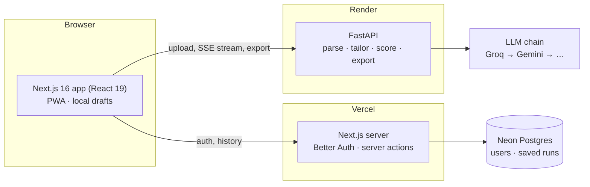

# Tailor: resume customizer

Paste a job description, upload your resume (PDF or DOCX), and get a version tailored to the role, with every change traceable to something you actually did.

**Live app:** https://resume-customizer-lac.vercel.app
**API:** https://resume-customizer-api-m69l.onrender.com/api/v1/health


## What it does

| Requirement | How |
|---|---|
| Job description input | Text area with live length validation (200 to 20,000 characters) and a focusable error summary |
| Resume upload | PDF and DOCX. Validated by file contents, not just extension. Shows name, size, pages and words, plus a preview of the extracted text |
| Parsing on the backend | PyMuPDF for PDF (including link annotations, so icon-only LinkedIn/GitHub links survive) and python-docx (including tables and headers) |
| LLM customization | Rewrites the summary, reorders and rephrases bullets toward the job's keywords, highlights matching skills, and suggests missing keywords honestly |
| Output and download | Exact page preview; download as **PDF (always one page), Word, LaTeX (Jake's Resume template) or plain text** |
| Error handling | Every failure has a stable code, a plain-language message and a fix: wrong file type, `.doc`, corrupt, encrypted or scanned PDFs, oversized files, short job descriptions, LLM outages and rate limits |

**Bonus features (all eight):**
- Match score and ATS score: before and after, with a per-component breakdown.
- Diff view with keep or revert for each change.
- Up to three versions per job, to compare.
- Choose which sections to tailor, and the tone.
- Streamed cover letter, editable.
- Accounts with saved history.
- Streaming progress for every pipeline step.

**Beyond the brief:**
- **One page, every time.** The PDF uses a Jake's Resume-style ATS layout with an embedded Unicode font. Typography tightens to a readable floor first; only then are the least relevant bullets trimmed, and the app says exactly what was trimmed.
- **LaTeX in and out.** Paste a `.tex` resume and the tailored text is written back into *your own template* (bullets, summary, skill rows) with the preamble and layout untouched. It is compiled on the server (Tectonic) with a live page preview, kept to one page, and can be edited, downloaded as `.tex` or PDF, or opened in Overleaf.
- **Raise your match toward 90%, honestly.** Tick posting skills you genuinely have but left off; the next version adds them to Skills and the summary (bullets still need evidence from that role).
- **Email verification and password reset** with 6-digit codes.
- **Installable PWA** with offline handling.

## How the tailoring stays honest

A tailored resume that claims things the candidate never did can pass a filter and fail the interview. Grounding is enforced twice:

1. **Prompt rules.**
   - No new employers, titles, dates, tools or metrics. Every number in the output must already exist in the resume.
   - A job skill may only appear in a bullet whose original role shows it.
   - Umbrella terms are allowed only with evidence. For example, "vector databases" is allowed if the resume lists Pinecone, and the model must name the exact resume words that prove it.
2. **A deterministic guard after the model** (`backend/app/features/tailor/guard.py`).
   - It reverts any rewritten bullet that adds a number, adds a job skill its role never showed, or drops a metric the original had.
   - It moves skills the resume doesn't show into suggestions instead.
   - It restores bullets the model dropped, and never lets a rewrite lose a job keyword or a job-relevant skill the original had, so tailoring can't lower the match.
   - It strips keyword-stuffing tags like "(React, FastAPI)" appended to bullets.
   - Every intervention is shown to the user as a flag.

Missing keywords become suggestions phrased as conditionals ("If you used Kafka for the event pipeline, mention it"). They are never added for you unless you confirm them.

**Reaching a high match without inventing anything:**
1. Matching counts spelling variants as the same skill ("full-stack" = "full stack" = "fullstack", RAG = retrieval-augmented generation), while whole-word meaning stays strict ("java" never matches "javascript").
2. If a version lands under 90%, one targeted second pass covers terms the resume can genuinely support; it is kept only if it scores higher.
3. The user can confirm missing skills they really have. On a real CV and job description this took the match from 75% to 89% automatically, and to 92% after confirming one skill.

## LLM provider and model

The chain is configured as `provider/model` entries tried in order (`LLM_CHAIN`). The default was chosen by benchmarking the real pipeline on a real CV and job description:

| Model | Full run | Match gain | Guard reverts | Notes |
|---|---|---|---|---|
| **Groq `openai/gpt-oss-120b`** (primary) | ~9 s | +6 | **0** | Fastest; most faithful to the source |
| **Gemini `gemini-3.1-flash-lite`** | ~19 s | +9 | 4 | Good gains; more invented claims for the guard to revert |
| Gemini `gemini-3-flash-preview` | ~56 s | +9 | 3 | Too slow for an interactive tool |
| Gemini 3.8 / 3.6 Flash | | | | Fallbacks; often "high demand" (503) on the free tier |

Free-tier notes: Gemini 2.5 models are retired for new keys, Pro models have no free quota, and Groq allows 8K tokens per minute *per model*.

How failover works:
- Each model is its own provider in the chain, so a rate limit or overload on one moves the request to the next in about a second.
- Every call has a hard wall-clock deadline, because httpx timeouts are per read.
- Every structured answer is validated against a strict JSON schema generated from the Pydantic models, with one retry that feeds back the validation error.

## Architecture



**Tailoring pipeline** (`POST /api/v1/tailor`, streamed as server-sent events):

1. Structure the resume text into JSON, and analyze the job (title, must-have skills, ATS keywords). These two run **in parallel**.
2. Score the original: deterministic match % and ATS readiness.
3. Tailor the requested sections, with strict JSON output.
4. Run the guard, re-score, and return the result with changes, flags and suggestions.

The **backend is stateless**: files and text live only for the length of a request. Persistence belongs to the web app and only applies to signed-in users who choose to keep history.

**Code layout:** organized by feature on both sides.

```
backend/app/
  core/            settings, error shape, rate limiting
  llm/             providers, router (failover, deadlines, validation), strict schemas
  features/        resume · job · tailor · scoring · cover_letter · export
frontend/src/
  app/             routes: / · sign-in · sign-up · history · account · api/auth
  features/        workspace · jobInput · resumeUpload · tailor · results · coverLetter · history · account · pwa
  components/      layout + UI primitives
  lib/api/         typed client generated from backend/openapi.json, SSE reader
  db/              Drizzle schema (Better Auth tables + saved_run)
```

## Tech stack

| Layer | Choices |
|---|---|
| Frontend | Next.js 16.4 (App Router, Cache Components, Turbopack), React 19.3, TypeScript, Tailwind CSS 4.3, Base UI 1.9, Phosphor Icons, Motion |
| Auth and data | Better Auth 1.7 (email and password), Drizzle ORM, Neon Postgres |
| Backend | Python 3.13, FastAPI 0.143 (native SSE), Pydantic 2, PyMuPDF, python-docx, slowapi, uv |
| LLM | Groq (OpenAI-compatible, strict JSON schema), Google Gemini (google-genai, Interactions API) |
| Documents | PyMuPDF Story (PDF), python-docx (Word), Tectonic/XeLaTeX (compiling LaTeX), Jake's Resume template (MIT) |
| Quality | Ruff, pytest (61 tests), Biome, Vitest, Playwright, GitHub Actions CI |
| Hosting | Vercel (web), Render (API, Docker), Neon (database) |

## Accessibility and UX

Built to WCAG 2.2 AA, with AAA contrast for text:
- **Contrast:** every text color pair is verified at 7:1 or better in light and dark themes, and control borders meet 3:1.
- **Keyboard and focus:** fully keyboard operable, with a skip link and one visible focus ring. Focus moves to error summaries, progress and results.
- **Screen readers:** live regions announce pipeline stages, saves and errors. The diff never relies on color alone (underline and strikethrough, plus "added"/"removed" for screen readers).
- **Touch:** targets are 44 px, and drag-and-drop always has a button alternative.
- **Preferences:** reduced-motion and forced-colors support.
- **Heuristics:** guided by Nielsen's heuristics and the Laws of UX:
  - One primary action per step, with advanced options collapsed.
  - Familiar patterns.
  - Results chunked into four tabs.
  - Undo and revert everywhere.
  - Inputs persist across reloads.

## Run it locally

Requirements: Python 3.13 with [uv](https://docs.astral.sh/uv/), Node 20.9+ with pnpm. Optional: [Tectonic](https://tectonic-typesetting.github.io/) for compiling LaTeX locally.

```bash
git clone https://github.com/vishwam-shah/resume-customizer.git
cd resume-customizer

# 1. Backend: http://localhost:8000 (API docs at /docs)
cd backend
cp .env.example .env            # add GROQ_API_KEY and/or GEMINI_API_KEY
uv sync
uv run uvicorn app.main:app --reload --port 8000

# 2. Frontend: http://localhost:3000 (in a second terminal)
cd frontend
cp .env.example .env.local      # fill in the variables listed below
pnpm install
pnpm db:migrate                 # creates the auth and history tables
pnpm dev
```

Then open http://localhost:3000 and click **Try an example** to run the whole flow with a sample resume and job.

**Environment variables** (values go in `.env` / `.env.local`, which are git-ignored; never commit them):

| Where | Variable | Required | Purpose |
|---|---|---|---|
| backend | `GROQ_API_KEY` | one LLM key | Free key at console.groq.com |
| backend | `GEMINI_API_KEY` | one LLM key | Free key at aistudio.google.com |
| backend | `CORS_ORIGINS` | yes | Frontend origin(s), e.g. `http://localhost:3000` |
| backend | `LLM_CHAIN` | no | Override the model order (`provider/model,...`) |
| backend | `TECTONIC_PATH` | no | Path to Tectonic if it isn't on `PATH` |
| frontend | `NEXT_PUBLIC_API_URL` | yes | Backend URL, e.g. `http://localhost:8000` |
| frontend | `DATABASE_URL` | for accounts | Postgres connection string (a free Neon project works) |
| frontend | `BETTER_AUTH_SECRET` | for accounts | Random 32+ character secret (`openssl rand -base64 32`) |
| frontend | `BETTER_AUTH_URL`, `NEXT_PUBLIC_SITE_URL` | for accounts | The site URL, e.g. `http://localhost:3000` |
| frontend | `GMAIL_USER`, `GMAIL_APP_PASSWORD` | no | Sends email verification and reset codes; without them, sign-up works without a code |

Without a database, everything except sign-in and history still works.

**Checks**

```bash
cd backend && uv run ruff check . && uv run pytest
cd frontend && pnpm lint && pnpm typecheck && pnpm test
```

After changing backend models, run `uv run python scripts/export_openapi.py` and `pnpm api:types` to regenerate the frontend's API types. CI fails if the schema is out of date.

## Deployment

- **API (Render, Docker):** the `render.yaml` Blueprint builds `backend/Dockerfile`: a multi-stage uv build, non-root user, healthcheck, Tectonic installed with common resume LaTeX packages pre-cached. Set `GROQ_API_KEY`, `GEMINI_API_KEY` and `CORS_ORIGINS` in the Render dashboard.
- **Continuous deployment:** GitHub Actions runs every check on each push to `main` and, only if all pass, triggers Render through its deploy hook (repository secret `RENDER_DEPLOY_HOOK`).
- **Web (Vercel):** project rooted at `frontend/`, functions pinned to Singapore (`sin1`) next to the database. Set the frontend variables above in Vercel.
- **Database (Neon):** Postgres in `ap-southeast-1`; schema migrations live in `frontend/drizzle/`.

## AI tools used

- **In the product:** Groq **`openai/gpt-oss-120b`** is the primary model, with Google **Gemini 3.1 Flash-Lite** and further Groq/Gemini models as automatic fallbacks (see *LLM provider and model*). They structure the resume, analyze the job, tailor the sections and write the cover letter. Every output is schema-validated and checked by the deterministic guard.
- **In development:** **Claude Code** (Anthropic) was used as an AI pair programmer for implementation, tests and documentation. Product decisions, requirements and review were mine; every change was verified with the automated tests and browser checks in this repository.

## Known limitations and trade-offs

- **Free tiers.** Render sleeps a free service after 15 minutes idle. The API pings its own public URL every 5 minutes to stay awake, with a GitHub Actions cron as a backup; if it does sleep, the UI explains the ~30 s wake-up. Groq and Gemini free quotas are small; the multi-model chain absorbs bursts, but heavy use can still hit "busy".
- **Scores are ours.** Match and ATS scores are transparent, deterministic heuristics (keyword coverage, sections, contact details, quantified impact). No tool can see inside a specific employer's ATS.
- **PDF/DOCX uploads get a standard layout.** A tailored PDF or Word resume is re-rendered in a clean single-column ATS layout rather than its original design. To keep your own design, paste LaTeX: it is edited in place.
- **One page means trimming.** When content doesn't fit, the least relevant bullets are left out of the one-page PDF; they stay in the tailored version and the app lists what was trimmed.
- **No OCR.** Scanned PDFs are detected and rejected with instructions, rather than read.
- **Rate limits are per instance**, in memory. Fine for a single instance; a shared store (Redis) would be needed to scale out.
- **PyMuPDF is AGPL-licensed.** This repository is open source, which complies; a closed-source product would need a commercial license or pdfplumber.

## Screenshots

| | |
|---|---|
|  |  |
|  |  |
|  |  |
