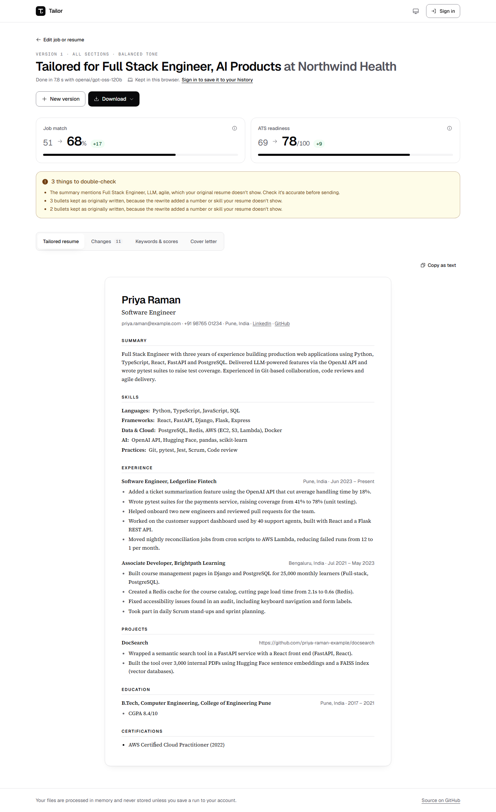
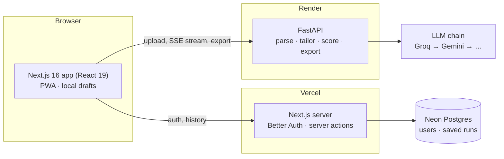
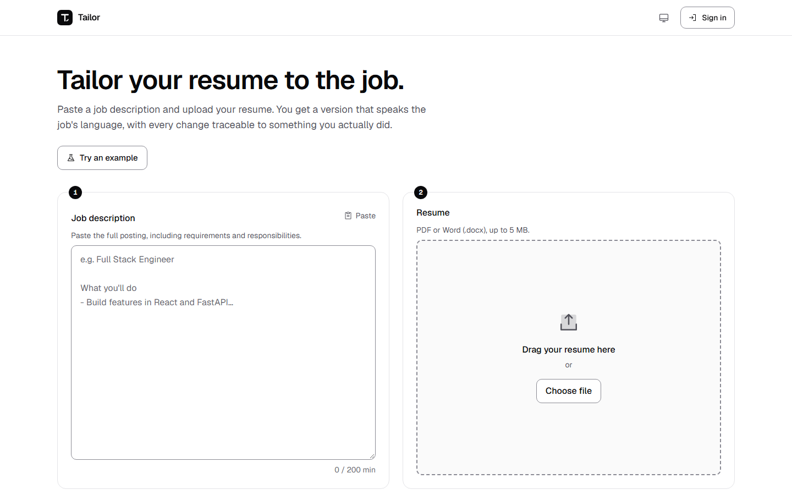
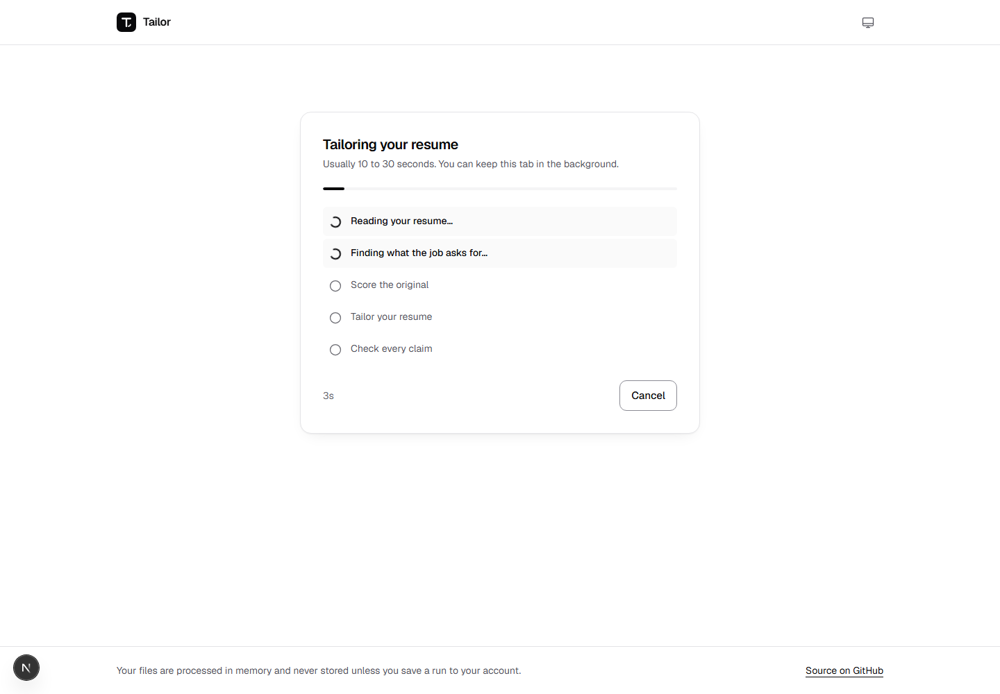
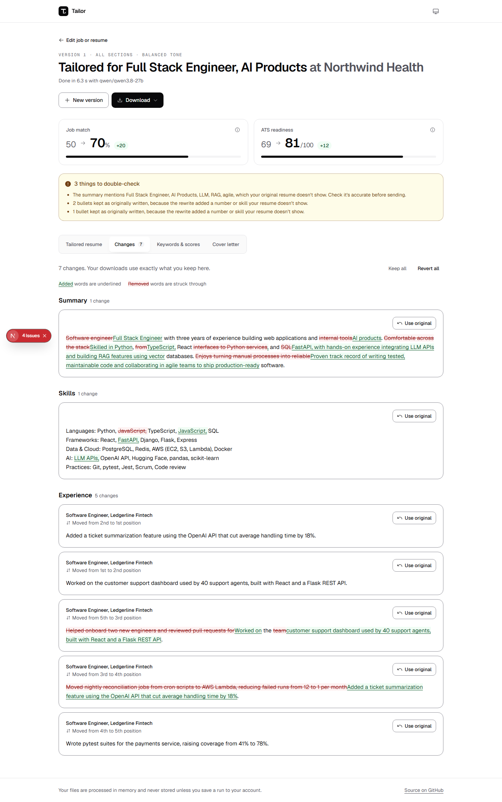
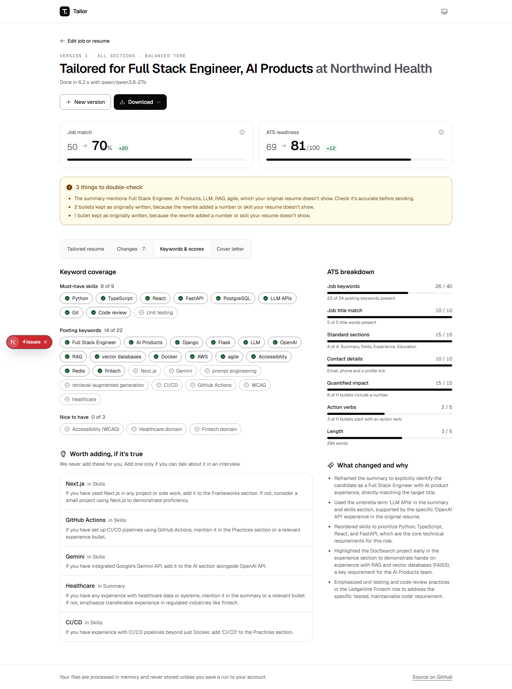
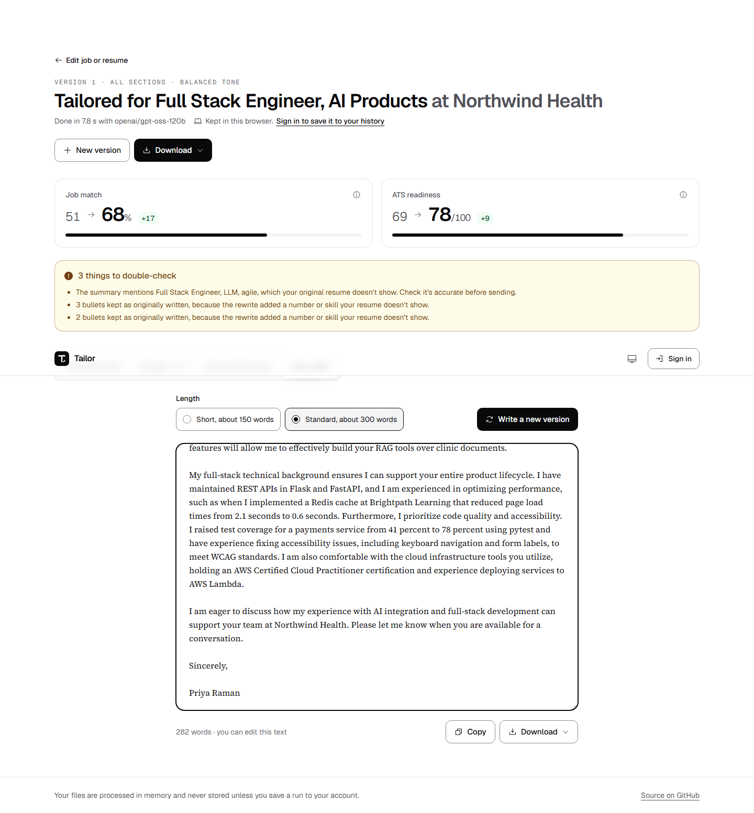
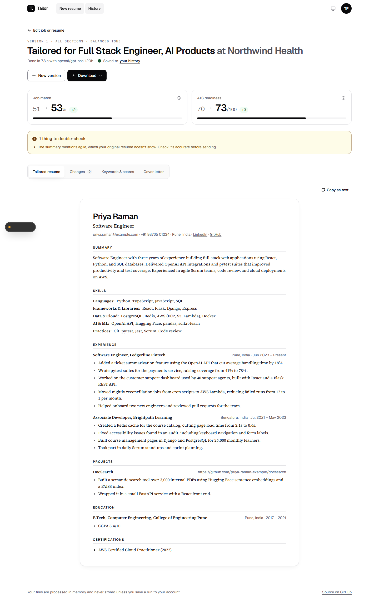

# Tailor: resume customizer

Paste a job description, upload your resume (PDF or DOCX), and get a version tailored to the role, with every change traceable to something you actually did.

**Live app:** https://resume-customizer-lac.vercel.app
**API:** https://resume-customizer-api-m69l.onrender.com/api/v1/health



## What it does

| Requirement | How |
|---|---|
| Job description input | Text area with live length validation (200 to 20,000 characters) and a focusable error summary |
| Resume upload | PDF and DOCX. Validated by file contents, not just extension. Shows name, size, pages and words, plus a preview of the extracted text |
| Parsing on the backend | PyMuPDF for PDF (including link annotations, so icon-only LinkedIn/GitHub links survive) and python-docx (including tables and headers) |
| LLM customization | Rewrites the summary, reorders and rephrases bullets toward the job's keywords, highlights matching skills, and suggests missing keywords honestly |
| Output and download | Document-style preview; download as **PDF, Word or plain text** |
| Error handling | Every failure has a stable code, a plain-language message and a fix: wrong file type, `.doc`, corrupt, encrypted or scanned PDFs, oversized files, short job descriptions, LLM outages and rate limits |

**Bonus features (all eight):**
- Match score and ATS score: before and after, with a per-component breakdown.
- Diff view with keep or revert for each change.
- Up to three versions per job, to compare.
- Choose which sections to tailor, and the tone.
- Streamed cover letter, editable.
- Accounts with saved history.
- Streaming progress for every pipeline step.

The app is also an **installable PWA** with offline handling.

## How the tailoring stays honest

A tailored resume that claims things the candidate never did can pass a filter and fail the interview. Grounding is enforced twice:

1. **Prompt rules.**
   - No new employers, titles, dates, tools or metrics. Every number in the output must already exist in the resume.
   - A job skill may only appear in a bullet whose original role shows it.
   - Umbrella terms are allowed only with evidence. For example, "vector databases" is allowed if the resume lists Pinecone, and the model must name the exact resume words that prove it.
2. **A deterministic guard after the model** (`backend/app/features/tailor/guard.py`).
   - It reverts any rewritten bullet that adds a number, adds a job skill its role never showed, or drops a metric the original had.
   - It moves skills the resume doesn't show into suggestions instead.
   - It restores bullets the model dropped.
   - Every intervention is shown to the user as a flag.

Missing keywords become suggestions phrased as conditionals ("If you used Kafka for the event pipeline, mention it"). They are never added for you.

## LLM provider and model

The chain is configured as `provider/model` entries tried in order (`LLM_CHAIN`). The default was chosen by benchmarking the real pipeline on a real CV and job description:

| Model | Full run | Match gain | Guard reverts | Notes |
|---|---|---|---|---|
| **Groq `openai/gpt-oss-120b`** (primary) | ~9 s | +6 | **0** | Fastest; most faithful to the source |
| **Gemini `gemini-3.1-flash-lite`** | ~19 s | +9 | 4 | Good gains; more invented claims for the guard to revert |
| Gemini `gemini-3-flash-preview` | ~56 s | +9 | 3 | Too slow for an interactive tool |
| Gemini 3.8 / 3.6 Flash | | | | Fallbacks; often "high demand" (503) on the free tier |

Free-tier notes: Gemini 2.5 models are retired for new keys, Pro models have no free quota, and Groq allows 8K tokens per minute *per model*.

How failover works:
- Each model is its own provider in the chain, so a rate limit or overload on one moves the request to the next in about a second.
- Every call has a hard wall-clock deadline, because httpx timeouts are per read.
- Every structured answer is validated against a strict JSON schema generated from the Pydantic models, with one retry that feeds back the validation error.

## Architecture



**Tailoring pipeline** (`POST /api/v1/tailor`, streamed as server-sent events):

1. Structure the resume text into JSON, and analyze the job (title, must-have skills, ATS keywords). These two run **in parallel**.
2. Score the original: deterministic match % and ATS readiness.
3. Tailor the requested sections, with strict JSON output.
4. Run the guard, re-score, and return the result with changes, flags and suggestions.

The **backend is stateless**: files and text live only for the length of a request. Persistence belongs to the web app and only applies to signed-in users who choose to keep history.

**Code layout:** organized by feature on both sides.

```
backend/app/
  core/            settings, error shape, rate limiting
  llm/             providers, router (failover, deadlines, validation), strict schemas
  features/        resume · job · tailor · scoring · cover_letter · export
frontend/src/
  app/             routes: / · sign-in · sign-up · history · account · api/auth
  features/        workspace · jobInput · resumeUpload · tailor · results · coverLetter · history · account · pwa
  components/      layout + UI primitives
  lib/api/         typed client generated from backend/openapi.json, SSE reader
  db/              Drizzle schema (Better Auth tables + saved_run)
```

## Tech stack

| Layer | Choices |
|---|---|
| Frontend | Next.js 16.4 (App Router, Cache Components, Turbopack), React 19.3, TypeScript, Tailwind CSS 4.3, Base UI 1.9, Phosphor Icons, Motion |
| Auth and data | Better Auth 1.7 (email and password), Drizzle ORM, Neon Postgres |
| Backend | Python 3.13, FastAPI 0.143 (native SSE), Pydantic 2, PyMuPDF, python-docx, slowapi, uv |
| LLM | Groq (OpenAI-compatible, strict JSON schema), Google Gemini (google-genai, Interactions API) |
| Quality | Ruff, pytest (40 tests), Biome, Vitest, Playwright, GitHub Actions CI |
| Hosting | Vercel (web), Render (API, Docker), Neon (database) |

## Accessibility and UX

Built to WCAG 2.2 AA, with AAA contrast for text:
- **Contrast:** every text color pair is verified at 7:1 or better in light and dark themes, and control borders meet 3:1.
- **Keyboard and focus:** fully keyboard operable, with a skip link and one visible focus ring. Focus moves to error summaries, progress and results.
- **Screen readers:** live regions announce pipeline stages, saves and errors. The diff never relies on color alone (underline and strikethrough, plus "added"/"removed" for screen readers).
- **Touch:** targets are 44 px, and drag-and-drop always has a button alternative.
- **Preferences:** reduced-motion and forced-colors support.
- **Heuristics:** guided by Nielsen's heuristics and the Laws of UX:
  - One primary action per step, with advanced options collapsed.
  - Familiar patterns.
  - Results chunked into four tabs.
  - Undo and revert everywhere.
  - Inputs persist across reloads.

## Run it locally

Requirements: Python 3.13 with [uv](https://docs.astral.sh/uv/), Node 20.9+ with pnpm.

```bash
# Backend: http://localhost:8000 (docs at /docs)
cd backend
cp .env.example .env          # add GROQ_API_KEY and/or GEMINI_API_KEY
uv sync
uv run uvicorn app.main:app --reload --port 8000

# Frontend: http://localhost:3000
cd frontend
cp .env.example .env.local    # API URL, DATABASE_URL, BETTER_AUTH_SECRET, BETTER_AUTH_URL
pnpm install
pnpm db:migrate               # creates the auth and history tables
pnpm dev
```

Accounts need a Postgres database (a free Neon project works). Without one, everything except sign-in and history still works.

**Checks**

```bash
cd backend && uv run ruff check . && uv run pytest
cd frontend && pnpm lint && pnpm typecheck && pnpm test
```

After changing backend models, run `uv run python scripts/export_openapi.py` and `pnpm api:types` to regenerate the frontend's API types. CI fails if the schema is out of date.

## Deployment

- **API:** Render Blueprint (`render.yaml`) builds `backend/Dockerfile`. It's a multi-stage uv build that runs as a non-root user, with a healthcheck. Set `GROQ_API_KEY`, `GEMINI_API_KEY` and `CORS_ORIGINS` in the dashboard.
- **Web:** Vercel project rooted at `frontend/`. Set `NEXT_PUBLIC_API_URL`, `DATABASE_URL`, `BETTER_AUTH_SECRET`, `BETTER_AUTH_URL` and `NEXT_PUBLIC_SITE_URL`.

## Known limitations and trade-offs

- **Free tiers.** Render sleeps a free service after 15 minutes idle. The API pings its own public URL every 5 minutes to stay awake, with a GitHub Actions cron as a backup; if it does sleep, the UI explains the ~30 s wake-up. Groq and Gemini free quotas are small; the multi-model chain absorbs bursts, but heavy use can still hit "busy".
- **Scores are ours.** Match and ATS scores are transparent, deterministic heuristics (keyword coverage, sections, contact details, quantified impact). No tool can see inside a specific employer's ATS.
- **Layout isn't preserved.** The tailored resume is re-rendered in a clean single-column ATS-safe layout. That is deliberate for ATS parsing, but it means the original visual design is not kept.
- **No OCR.** Scanned PDFs are detected and rejected with instructions, rather than read.
- **Rate limits are per instance**, in memory. Fine for a single instance; a shared store (Redis) would be needed to scale out.
- **PyMuPDF is AGPL-licensed.** This repository is open source, which complies; a closed-source product would need a commercial license or pdfplumber.

## Screenshots

| | |
|---|---|
|  |  |
|  |  |
|  |  |
